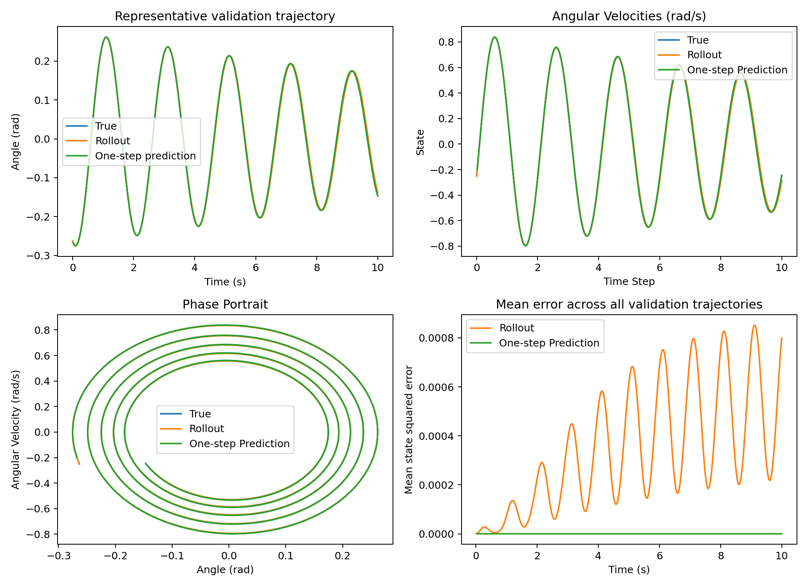
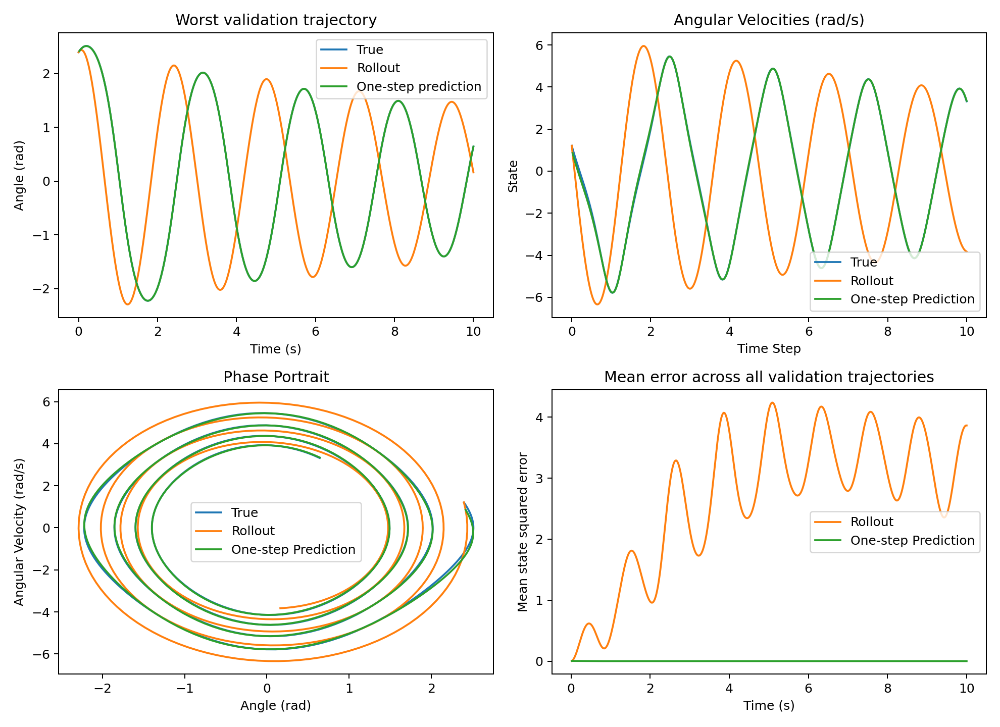

# DMD baseline: predicting pendulum motion

I started with DMD to see how far a simple linear model could go before adding
nonlinear features or neural networks. The question for this experiment was:
how well can DMD predict a damped pendulum, and how much does the answer change
when it has to predict an entire trajectory from one initial state?

These are validation results. I have not used the held-out test split for the
results in this report.

## Experiment setup

The state consists of the pendulum's angle and angular velocity. I simulated
the dynamics with gravity 9.81 m/s², length 1 m, and damping coefficient 0.1 s⁻¹.
I then fitted a matrix `A` using `A = Y @ pinv(X)`, where each column of `X`
is a state and the corresponding column of `Y` is the next state.

I used two ranges of initial conditions:

| Setting | Small-angle | Broad-motion |
|---|---|---|
| Initial angle (rad) | −0.5 to 0.5 | −2.5 to 2.5 |
| Initial angular velocity (rad/s) | −0.5 to 0.5 | −2 to 2 |
| Trajectories per seed | 200 | 200 |
| Duration | 10 seconds | 10 seconds |
| Sampling interval | 0.02 seconds | 0.02 seconds |

For each regime, I used seeds 42, 43, and 44. Each dataset was split into 140
training, 30 validation, and 30 test trajectories. The split keeps entire
trajectories together. Each regime and seed gets its own fitted matrix, so this
experiment does not test a small-angle model on broad-motion data.

I evaluated two types of prediction. One-step prediction uses the true state
at each time to predict the next state. A recursive rollout starts from the
true initial state and then uses its own predictions as inputs. I excluded the
supplied initial state from the error calculation. I also used persistence,
which predicts that the next state equals the current state, as a one-step
reference.

## Results

Each value below is the mean ± sample standard deviation across the three
seed-level scores. Each seed-level score averages over all 30 validation
trajectories and their predicted times.

| Validation metric | Small-angle | Broad-motion |
|---|---:|---:|
| One-step MSE | 3.807e−8 ± 1.567e−9 | 3.978e−4 ± 2.097e−5 |
| Recursive rollout MSE | 3.480e−4 ± 1.702e−5 | 2.689 ± 0.130 |
| Persistence one-step MSE | 6.262e−4 ± 5.574e−5 | 8.736e−3 ± 9.384e−4 |
| Rollout angle MSE (rad²) | 6.647e−5 ± 3.431e−6 | 0.656 ± 0.037 |
| Rollout angular-velocity MSE ((rad/s)²) | 6.295e−4 ± 3.061e−5 | 4.721 ± 0.223 |

The aggregate state MSE averages angle and angular-velocity squared errors
without normalization. Since these have different units and scales, I included
the separate errors as well. The raw scores alone are not a scale-independent
comparison between the two regimes.

DMD beats persistence on one-step prediction in both regimes. The larger
difference appears in recursive prediction: broad-motion rollout MSE is 2.645,
2.835, and 2.586 for seeds 42, 43, and 44, respectively. The result is therefore
not limited to one sampled dataset.

The variation across seeds measures sensitivity to the sampled data. DMD fitting
itself is deterministic for a fixed dataset. This is different from the
variation across individual trajectories recorded in each metrics file.

## What the predictions show

The small-angle example is the validation trajectory whose rollout MSE is
closest to the median for seed 42.

The broad-motion example has the highest rollout MSE among that seed's 30
validation trajectories. Its recursive prediction reaches peaks earlier than
the true trajectory, and the timing difference accumulates. The one-step
predictions remain visually close to the true states because they receive a
fresh true state at every step.

In both figures, the first three panels show the selected trajectory. The final
panel averages errors across all validation trajectories. Time is in seconds;
the velocity panel's horizontal label still says “Time Step,” and its vertical
quantity is angular velocity in rad/s.

This behavior is consistent with the small-angle approximation `sin(theta) ≈
theta`: near equilibrium, the pendulum is approximately linear. Larger motions
are harder to describe with one linear state-transition matrix. The plots
suggest that timing error is an important part of the broad-motion failure,
although I have not separately measured frequency and amplitude errors.

All six fitted matrices have spectral radius below one. Their predictions can
still be inaccurate, so checking that a model is stable is not enough to show
that it captures the motion correctly.

## Limitations and next step

These experiments use noise-free simulated data, one physical parameter setting,
and three dataset seeds. Damping also means that later states approach equilibrium,
which affects a score averaged over time. The results do not yet establish
performance on measured data, different physical parameters, or initial
conditions outside the training distribution.

My next step is to compare DMD with EDMD using a fixed set of nonlinear features.
I want to find out whether those features improve broad-motion rollouts before
moving to learned representations. I will use the same trajectory splits and
metrics, choose features and regularization using validation data, and reserve
the test split for final comparisons.

## Reproducing the results

From the repository root, run `python scripts/evaluate_dmd.py` in the project
environment. The script currently runs the seed set in `small_config` (44 when
this report was written); `broad_config` inherits it. Set that seed to 42, 43,
and 44 in turn to reproduce all six runs.

The saved settings, fitted matrices, per-trajectory rollout scores, and figures
are in [small_angle](benchmarks/dmd/small_angle/) and
[broad_motion](benchmarks/dmd/broad_motion/), organized by seed.
