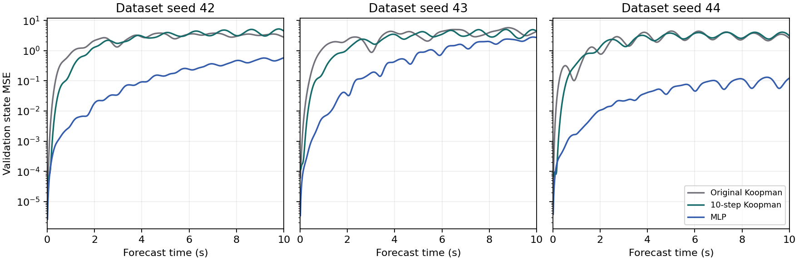

# Broad-motion validation results

Each model used a budget of 100 epochs and model seed 42. Each dataset contains 140 training, 30 validation, and 30 test trajectories. Models within a seed were scored on identical validation trajectories. The table gives the mean and sample standard deviation across the three dataset seeds. State MSE averages squared angle and angular velocity errors in their original units.

| Metric | Original Koopman | 10-step Koopman | MLP |
|---|---:|---:|---:|
| One-step MSE | 1.002e-05 ± 1.63e-06 | 1.371e-05 ± 4.68e-06 | 7.838e-07 ± 3.13e-07 |
| Rollout MSE at 0.2 s | 0.0209 ± 0.0162 | 0.0005365 ± 0.000202 | 0.0002127 ± 4.8e-05 |
| Rollout MSE at 1 s | 0.7397 ± 0.571 | 0.2549 ± 0.0932 | 0.003822 ± 0.00236 |
| Mean rollout MSE over 10 s | 2.717 ± 0.357 | 2.636 ± 0.16 | 0.3993 ± 0.474 |

## Paired results

| Dataset seed | Model | One-step MSE | At 0.2 s | At 1 s | Mean over 10 s |
|---:|---|---:|---:|---:|---:|
| 42 | [Original Koopman](dataset_seed_42/model_seed_42/epochs_100/checkpoint_336980b08143/metrics.json) | 1.1298e-05 | 0.012354 | 0.81336 | 2.6124 |
| 42 | [10-step Koopman](dataset_seed_42/model_seed_42/epochs_100/checkpoint_3c38fb8867d8/metrics.json) | 1.6602e-05 | 0.00060384 | 0.20015 | 2.7513 |
| 42 | [MLP](../../mlp/broad_motion/dataset_seed_42/model_seed_42/epochs_100/checkpoint_85e2da7c72f1/mlp/metrics.json) | 1.1449e-06 | 0.00025984 | 0.0033827 | 0.2066 |
| 43 | [Original Koopman](dataset_seed_43/model_seed_42/epochs_100/checkpoint_b29d5f7902da/metrics.json) | 8.1772e-06 | 0.010726 | 1.2703 | 3.1148 |
| 43 | [10-step Koopman](dataset_seed_43/model_seed_42/epochs_100/checkpoint_8823402b01a6/metrics.json) | 1.6229e-05 | 0.00069668 | 0.20197 | 2.7036 |
| 43 | [MLP](../../mlp/broad_motion/dataset_seed_43/model_seed_42/epochs_100/checkpoint_318b7ad80631/mlp/metrics.json) | 6.1502e-07 | 0.00016382 | 0.0063738 | 0.9394 |
| 44 | [Original Koopman](dataset_seed_44/model_seed_42/epochs_100/checkpoint_ac7b3f8a044a/metrics.json) | 1.0577e-05 | 0.039625 | 0.13533 | 2.4248 |
| 44 | [10-step Koopman](dataset_seed_44/model_seed_42/epochs_100/checkpoint_be079c425d42/metrics.json) | 8.3101e-06 | 0.00030894 | 0.36254 | 2.4541 |
| 44 | [MLP](../../mlp/broad_motion/dataset_seed_44/model_seed_42/epochs_100/checkpoint_7908c0d3cb6e/mlp/metrics.json) | 5.9152e-07 | 0.00021437 | 0.0017091 | 0.051957 |

## Oscillation timing

For each validation trajectory, the interval between its first two downward angle-zero crossings estimates its first complete oscillation period. Crossing times were linearly interpolated between samples. All 30 reference trajectories and all 30 forecasts per seed had two such crossings. The middle 80% of the measured periods spanned a much wider range than the 10-step Koopman forecasts.

| Dataset seed | Simulated period, 10th–90th percentile (s) | 10-step Koopman period, 10th–90th percentile (s) |
|---:|---:|---:|
| 42 | 2.036–2.540 | 2.231–2.319 |
| 43 | 2.018–2.565 | 2.204–2.320 |
| 44 | 2.033–2.541 | 2.203–2.306 |

Short-rollout training reduced error at the 0.2-second training horizon on all three seeds. It reduced error at one second on two seeds and over the full rollout on one seed. The narrow predicted period range suggests timing drift as one contributor to long-range error. A matched small-angle benchmark would test whether that timing discrepancy shrinks when the simulated periods vary less.
