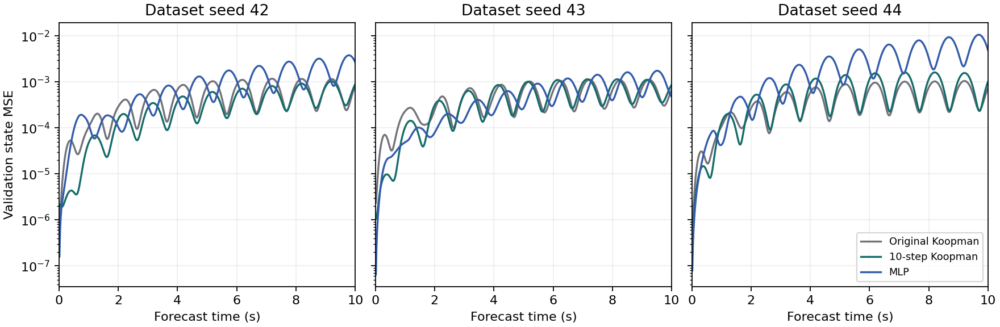
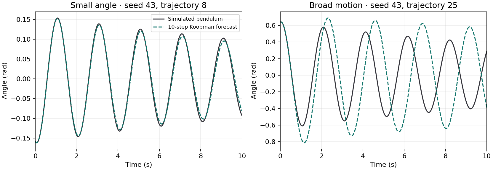

# Small-angle validation results

Each model used a budget of 100 epochs and model seed 42. Each dataset contains 140 training, 30 validation, and 30 test trajectories. Models within a seed were scored on identical validation trajectories. The table gives the mean and sample standard deviation across the three dataset seeds. State MSE averages squared angle and angular velocity errors in their original units.

| Metric | Original Koopman | 10-step Koopman | MLP |
|---|---:|---:|---:|
| One-step MSE | 4.331e-07 ± 1.45e-07 | 6.97e-07 ± 3.54e-07 | 5.911e-08 ± 2.17e-08 |
| Rollout MSE at 0.2 s | 2.921e-05 ± 1.48e-05 | 5.17e-06 ± 2.34e-06 | 6.264e-06 ± 5.71e-07 |
| Rollout MSE at 1 s | 0.0001466 ± 7.23e-05 | 9.322e-05 ± 4.25e-05 | 7.141e-05 ± 4.44e-05 |
| Mean rollout MSE over 10 s | 0.0004726 ± 3.11e-05 | 0.0004866 ± 0.00014 | 0.001468 ± 0.00122 |

## Paired results

| Dataset seed | Model | One-step MSE | At 0.2 s | At 1 s | Mean over 10 s |
|---:|---|---:|---:|---:|---:|
| 42 | [Original Koopman](dataset_seed_42/model_seed_42/epochs_100/checkpoint_50ca37ca5661/metrics.json) | 5.0061e-07 | 2.2109e-05 | 0.00010232 | 0.00049241 |
| 42 | [10-step Koopman](dataset_seed_42/model_seed_42/epochs_100/checkpoint_615861d002af/metrics.json) | 1.0976e-06 | 2.551e-06 | 4.6821e-05 | 0.00034623 |
| 42 | [MLP](../../mlp/small_angle/dataset_seed_42/model_seed_42/epochs_100/checkpoint_6a860141d134/mlp/metrics.json) | 7.676e-08 | 5.9225e-06 | 0.00012258 | 0.0010142 |
| 43 | [Original Koopman](dataset_seed_43/model_seed_42/epochs_100/checkpoint_af2e1c9abe30/metrics.json) | 5.3261e-07 | 4.6172e-05 | 0.00023012 | 0.00048863 |
| 43 | [10-step Koopman](dataset_seed_43/model_seed_42/epochs_100/checkpoint_9d335e6396ef/metrics.json) | 5.6737e-07 | 5.8916e-06 | 0.00010253 | 0.00048713 |
| 43 | [MLP](../../mlp/small_angle/dataset_seed_43/model_seed_42/epochs_100/checkpoint_1bd90d8510fe/mlp/metrics.json) | 3.4892e-08 | 6.9234e-06 | 4.8767e-05 | 0.00054309 |
| 44 | [Original Koopman](dataset_seed_44/model_seed_42/epochs_100/checkpoint_238cee20ed56/metrics.json) | 2.6614e-07 | 1.9359e-05 | 0.00010744 | 0.00043683 |
| 44 | [10-step Koopman](dataset_seed_44/model_seed_42/epochs_100/checkpoint_e176871b9381/metrics.json) | 4.2585e-07 | 7.0689e-06 | 0.0001303 | 0.00062647 |
| 44 | [MLP](../../mlp/small_angle/dataset_seed_44/model_seed_42/epochs_100/checkpoint_9b02d33f93b9/mlp/metrics.json) | 6.568e-08 | 5.9462e-06 | 4.2878e-05 | 0.0028473 |

## Timing and representative trajectories

Period is the time between the first two downward angle-zero crossings, using linear interpolation. Each row pools the three dataset seeds. Period errors are paired within trajectory.

| Regime | Model | Measurable cycles | Median absolute period error (s) | Simulated period, middle 80% (s) | Predicted period, middle 80% (s) |
|---|---|---:|---:|---:|---:|
| small angle | Original Koopman | 90/90 | 0.00702 | 2.0072–2.0265 | 2.0167–2.0199 |
| small angle | 10-step Koopman | 90/90 | 0.00715 | 2.0072–2.0265 | 2.0148–2.0207 |
| small angle | MLP | 90/90 | 0.00400 | 2.0072–2.0265 | 2.0124–2.0315 |
| broad motion | Original Koopman | 81/90 | 0.18230 | 2.0238–2.5209 | 2.2285–2.3382 |
| broad motion | 10-step Koopman | 90/90 | 0.18296 | 2.0249–2.5628 | 2.2042–2.3193 |
| broad motion | MLP | 90/90 | 0.01112 | 2.0249–2.5628 | 2.0329–2.6693 |

Each panel shows the lower-median trajectory (rank 45 of 90) by 10-step Koopman rollout MSE within that regime. The vertical axes use each regime’s angle range.

